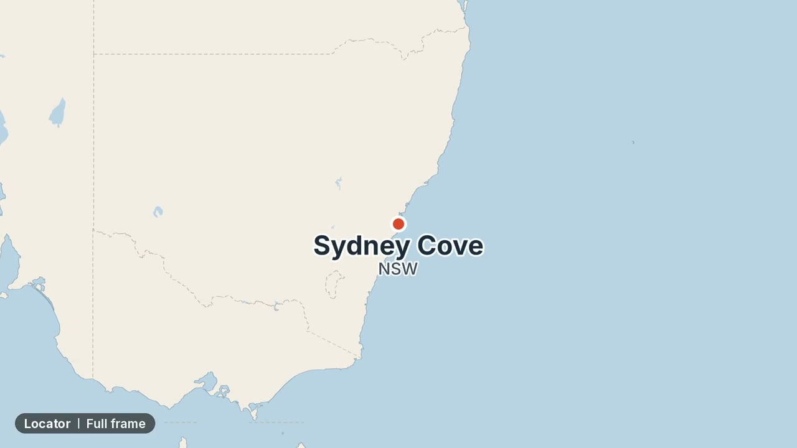
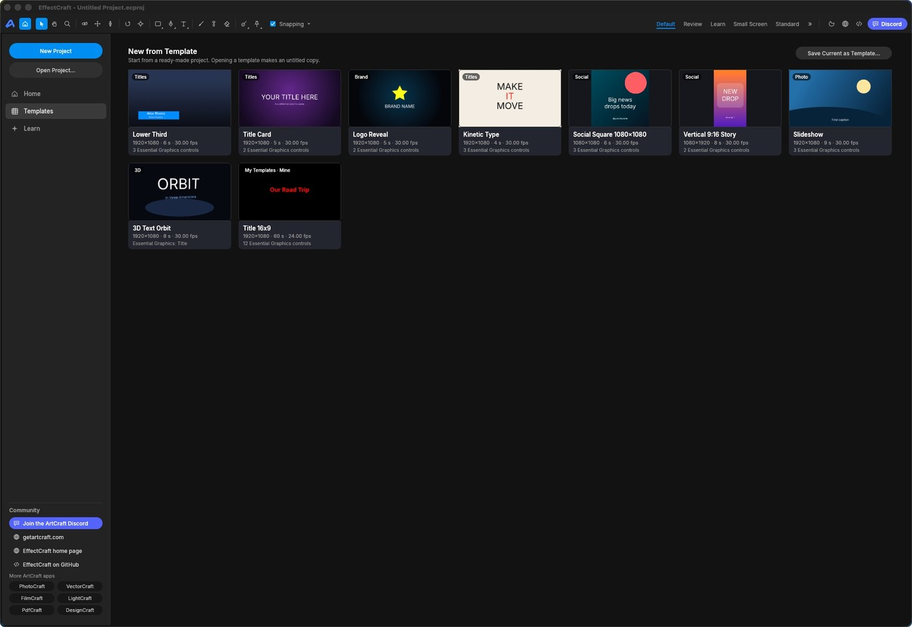

# Pixie's Craft Templates


**[Sponsored By PixBack - Photo and Video Backup to Google Photos](https://getpixback.com/)**

**[⬇ Download all templates (zip)](https://github.com/gkirkendall/pixies-craft-templates/releases/latest/download/pixies-craft-templates.zip)**: every template, its fonts and the install steps.

Free motion-graphics templates for the Craft apps, starting with [EffectCraft](https://github.com/storytold/effectcraft): map cards,
lower thirds and more, each with named controls you can edit in the app or fill from a script.

This is an independent project; it is not made or endorsed by the EffectCraft or ArtCraft teams.

[](https://gkirkendall.github.io/pixies-craft-templates/demo/showreel.mp4)

**[Watch the showreel](https://gkirkendall.github.io/pixies-craft-templates/demo/showreel.mp4)** (77 s), or the [Australia trip demo](https://gkirkendall.github.io/pixies-craft-templates/demo/australia_trip/demo.mp4) (64 s), which uses
the templates together, from the opening title and map to a Sign-off. Each template's folder has its own short demo in `previews/`.
Every reel opens on a title page (the template, its version and the EffectCraft versions it was tested with) and ends on the
credits and links. The demo videos show Gregory Kirkendall's own photos
and are not under the templates' licence (see [CREDITS.md](CREDITS.md)).

Check out the [catalogue page](https://gkirkendall.github.io/pixies-craft-templates/)! It shows a demo reel and screen shots of every template.

## Templates

<!-- catalog:start -->
| Template | App | Kind | Sizes | Tested with | Description |
|---|---|---|---|---|---|
| [Corner Logo](effectcraft/logos/corner_logo/) | effectcraft | motion | 16x9, 9x16 | 0.13.0 | A logo of any shape fitted in a square box in a chosen corner; it fades and rises in, and fades out by the end. |
| [Basic Lower Third](effectcraft/lower_thirds/basic/) | effectcraft | motion | 16x9, 9x16 | 0.13.0 | A dark bar with a title and subtitle slides in from the left, holds, and fades out; the bar fits the text. |
| [Box Wipe Lower Third](effectcraft/lower_thirds/box_wipe/) | effectcraft | motion | 16x9, 9x16 | 0.13.0 | A line sweeps in, a see-through box wipes open and an underlined script title and subtitle fade in; it wipes shut before Duration. |
| [Locator](effectcraft/maps/locator/) | effectcraft | motion | 16x9, 9x16 | 0.13.0 | Zooms from a whole country to one place, then a pin, the place name and a subtitle appear; full frame or a corner card. |
| [Route Leg](effectcraft/maps/route_leg/) | effectcraft | motion | 16x9, 9x16 | 0.13.0 | A line draws itself between two places on a map, with a pin and name at each end; full frame or a corner card. |
| [Glint](effectcraft/overlays/glint/) | effectcraft | motion | 16x9, 9x16 | 0.13.0 | One four-point star glint that pops in, turns a little and fades over 1 s, with a soft glow; place as many as you like. |
| [Glint Set](effectcraft/overlays/glint_set/) | effectcraft | motion | 16x9, 9x16 | 0.13.0 | Six glints already placed and timed one after another across a title, ready to drop over a title picture. |
| [Animated Title](effectcraft/titles/animated_title/) | effectcraft | motion | 16x9, 9x16 | 0.13.0 | A title that animates in and out letter by letter, word by word or line by line, in one of eight styles; *starred* words take a highlight colour. |
| [Credits](effectcraft/titles/credits/) | effectcraft | motion | 16x9, 9x16 | 0.13.0 | A title in quotes in tall condensed capitals with up to five credit lines under it, centred; empty lines close up. |
| [Sign-off](effectcraft/titles/sign_off/) | effectcraft | motion | 16x9, 9x16 | 0.13.0 | One line such as “Thank you for watching” between two hearts that follow its width; fades in, hearts pop. |
| [Title](effectcraft/titles/title/) | effectcraft | motion | 16x9, 9x16 | 0.13.0 | A title line with an optional small spaced-out label over it, in the centre, bottom centre or a corner; fades and rises in. |
| [Typewriter](effectcraft/titles/typewriter/) | effectcraft | motion | 16x9, 9x16 | 0.13.0 | Text that types itself letter by letter with a blinking cursor, and can erase itself again; the finished line is centred. |
| [Fill the Frame](effectcraft/utility/fill_frame/) | effectcraft | motion | 16x9, 9x16 | 0.13.0 | Shows a picture or clip of any shape whole, over a blurred, darkened copy of itself that fills the frame, instead of black bars. |
<!-- catalog:end -->

## How to install

1. **Get EffectCraft** 0.13 or later: [getartcraft.com/apps/effectcraft](https://getartcraft.com/apps/effectcraft).
2. **Download:** [every template in one ZIP](https://github.com/gkirkendall/pixies-craft-templates/releases/latest/download/pixies-craft-templates.zip), with their fonts and a README; or one template at a time from
   the [catalogue page](https://gkirkendall.github.io/pixies-craft-templates/) (a link per size, 16x9 and 9x16), or from the
   [latest release](https://github.com/gkirkendall/pixies-craft-templates/releases/latest).
3. **Install the fonts:** from the ZIP's `fonts` folder (or [the fonts alone](https://github.com/gkirkendall/pixies-craft-templates/releases/latest/download/pixies-craft-templates-fonts.zip));
   double-click a font file to install it (on Linux, copy it to `~/.local/share/fonts`). All are free (SIL Open Font License).
   EffectCraft swaps a missing font for its own.
4. **Use it:** in EffectCraft, **File ▸ Import ▸ Essential Graphics Template…**, then change its text, colours, fonts and timing
   in the Essential Graphics panel. **Or start a new project from it:** copy the `.ectemplate` file into EffectCraft's
   `Templates` folder (create it if it isn't there): `~/Library/Application Support/EffectCraft/Templates` on macOS,
   `%APPDATA%\EffectCraft\Templates` on Windows, `~/.config/effectcraft/Templates` on Linux. It then shows on the Home screen
   under **Templates ▸ New from Template**, marked "My Templates", and opening it makes an untitled copy. To reach the folder:
   on macOS, Finder ▸ Go ▸ Go to Folder… (Shift-Command-G) and paste the path; on Windows, paste the path into File
   Explorer's address bar.

   

5. **From a script** (for tools that make videos): `tools/render.py`, below.

## Using a template

- **In EffectCraft:** import the `.ectemplate` file for your EffectCraft from the template's version folder (for example
  `effectcraft-0.13/templates/`; the "Tested with" column says which versions each was tested on), as in step 4 above.
- **From a script** (Python 3 and EffectCraft's command-line tool, `effectcraft-cli`):

  ```
  python3 tools/render.py effectcraft/maps/route_leg --variant 16x9 --values my.values.json --out leg.mp4
  ```

  A values file maps control names to values. Each template's `examples/` folder has one to start from, and its README lists every
  control.

Every piece of text in a template has a font control that takes any font installed on your computer. `tools/render.py` checks
the fonts before rendering and, if one is missing, stops and names the file to install from `fonts/`
(`tools/render.py TEMPLATE --check-fonts` checks without rendering). Opening a template by hand in EffectCraft, install the fonts
its README lists first: EffectCraft silently swaps a missing font for its own.

**With an AI agent:** [SKILL.md](SKILL.md) teaches an agent (Claude Code or another) to fill, render and build these templates.
For Claude Code, link it in: `mkdir -p ~/.claude/skills/craft-templates && ln -s "$PWD/SKILL.md" ~/.claude/skills/craft-templates/SKILL.md`.

Each template lives in `<app>/<category>/<template>/`, with one complete folder per app-version line (`effectcraft-0.13/`, …), so a
template that a new EffectCraft release breaks is fixed in a new folder while the old one keeps working for people who cannot
upgrade. Each folder has a `template.json` manifest (sizes, controls, defaults, and the versions it was **tested** on) and a README.
`tools/render.py` picks the folder for your installed EffectCraft (`--which` shows it). `tools/verify.py --all --effectcraft-cli PATH`
tests every template with a given EffectCraft and records the result; `tools/catalog.py` checks every template and regenerates the
list above.

## Licence

MIT OR Apache-2.0, at your option (`LICENSE-MIT`, `LICENSE-APACHE`). Videos you make with these templates are yours.

Everything in this repository can be shared freely: the fonts are under the SIL Open Font License, and any other third-party material
is public domain or openly licensed. [CREDITS.md](CREDITS.md) lists each item and its licence. Some templates need a credit in the
videos you make with them (for example "© OpenStreetMap" on maps drawn from OpenStreetMap data); each template's README says when.
